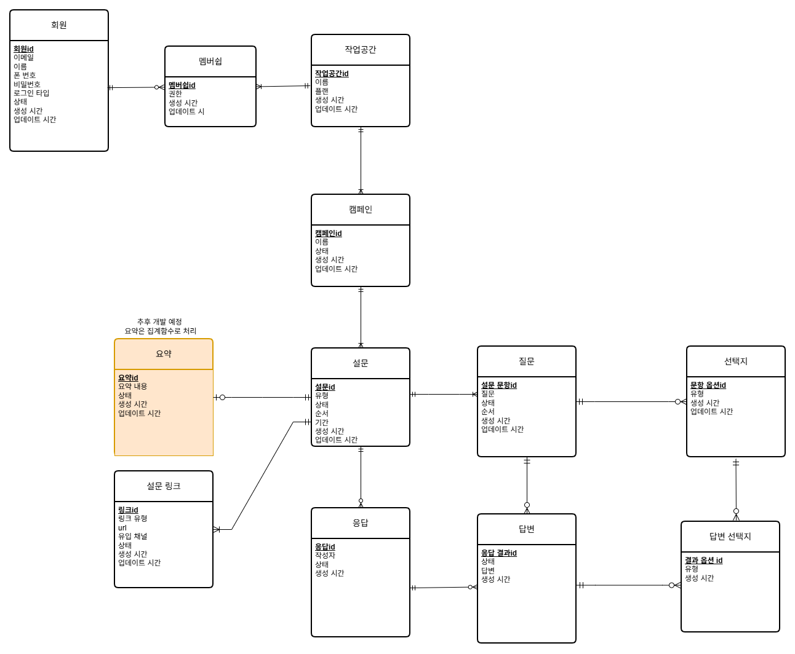

# Insight Platform

QR 코드 및 링크 기반 설문조사 플랫폼

## 1. Project Overview

## Key Features

### Workspace & Membership
- 회원가입 시 개인 작업공간 자동 생성
- 여러 작업공간 참여 및 관리
- 작업공간별 역할 기반 권한 관리 (OWNER, ADMIN, MEMBER)
- Free / Pro 구독 관리

### Campaign & Survey
- 캠페인별 설문 생성 및 관리
- 동적 질문 및 선택지 구성
- 설문 임시저장 및 발행
- 발행 후 질문 수정 지원
- 로그인 없는 설문 참여

### QR & Channel Tracking
- 설문별 QR 코드 및 공유 링크
- 유입 채널별 링크 관리
- 채널별 응답 수 추적

### Analytics
- 설문별 응답 현황
- 질문별 응답 통계 및 선호도 분석
- 채널별 응답 비교
- 대시보드 시각화

## Database Design

### Conceptual ERD

### Design Decisions
- User와 Workspace의 N:M 관계를 Membership으로 분리
- 작업공간별 권한을 Membership에서 관리
- 구독 정보를 Subscription으로 분리
- 캠페인과 설문의 관계 모델링

## Documentation

- [Functional Requirements](docs/requirements/functional-requirements.md)
- [Database Design Decisions](docs/database/design-decisions.md)

## 3. Tech Stack

## 4. System Architecture
(추후 작성)

## 5. Database Design

### 5.1 Conceptual Model

### 5.2 Logical Model
(추후 작성)

### 5.3 Physical Model
(추후 작성)

## 6. API Documentation
(추후 작성)

## 7. Getting Started
(개발 환경 및 실행 방법)

## 8. Technical Challenges & Decisions
(개발 과정에서 해결한 문제와 기술적 의사결정)
